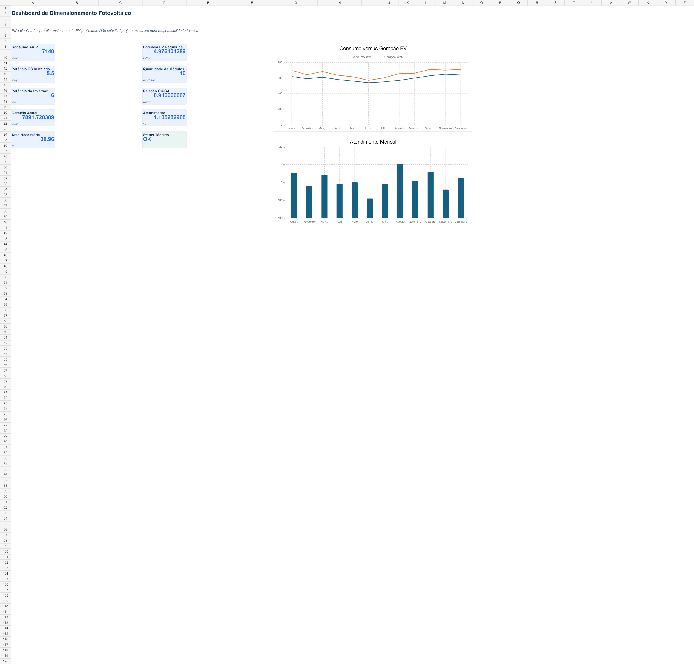

# Calculadora de Dimensionamento e Engenharia Fotovoltaica
### *Solar PV Engineering & String Sizing Calculator*

[](https://luscaarmstrong1.github.io/solar-pv-sizing-calculator/)
[](https://lucas-santos-portfolio-zeta.vercel.app/)
[](https://www.linkedin.com/in/lucasssantos1/)
[](https://github.com/luscaarmstrong1/solar-pv-sizing-calculator)

> **Camada 09 • Ecossistema de Engenharia, Energia, Dados & Automação**
> Dimensionamento técnico de geradores FV: cálculo de potência por HSP/PR, coordenação CC/CA (FDI), arranjo inteiro de strings por MPPT e verificação térmica de tensão Voc/Vmp.

---

## Acesse o Simulador Interativo e Demonstração Online

- **Simulador Paramétrico Web (GitHub Pages):** [https://luscaarmstrong1.github.io/solar-pv-sizing-calculator/](https://luscaarmstrong1.github.io/solar-pv-sizing-calculator/)
- **Vitrine no Portfólio Principal:** [https://lucas-santos-portfolio-zeta.vercel.app/#arquitetura](https://lucas-santos-portfolio-zeta.vercel.app/#arquitetura)

---

## Visão Geral e Problema de Engenharia

Ferramenta de engenharia para dimensionamento técnico de sistemas fotovoltaicos: cálculo de potência por HSP e perdas detalhadas, seleção de módulos e inversores, coordenação CC/CA e validação térmica de strings MPPT em Python, Streamlit e Web.

### Indicadores-Chave do Projeto (Caso-Base)

| Indicador Técnico | Resultado / Escopo | Detalhamento de Engenharia |
| :--- | :--- | :--- |
| **Cálculo de PR** | `Multiplicativo` | Térmica, cabos CC/CA, inversor e sujidade |
| **Arranjo de Strings** | `Inteiro por MPPT` | Sem criação de módulos fracionados |
| **Validação Elétrica** | `Voc(Tmin) & Vmp` | Janela operacional do inversor |
| **Balanço Mensal** | `12 Meses (HSP)` | Geração, excedente e compensação |

---

## Arquitetura do Sistema e Fluxo de Modelagem

1. **Etapa 01:** Levantamento Energético & Recurso Solar (Consumo mensal, disponibilidade da rede e HSP ponderada por mês)
2. **Etapa 02:** Cálculo de Perdas & Potência Requerida (Composição de PR e determinação do número inteiro de módulos)
3. **Etapa 03:** Coordenação de Strings & MPPT (Cálculo dos limites térmicos de tensão Voc a frio e Vmp a quente por entrada MPPT)
4. **Etapa 04:** Validação de Engenharia & Memorial (Checagem automática de corrente Isc/Imp, relação CC/CA, área ocupada e geração anual)

---

## Fundamentação Física, Matemática e Regulatória

### 1. Tensão de Circuito Aberto na Temperatura Mínima
```text
V_oc(T_min) = N_s · V_oc,STC · [1 + (β_Voc / 100) · (T_min - 25°C)] ≤ V_max,inversor
```

### 2. Tensão de Máxima Potência em Operação Quente
```text
V_mp(T_cell,max) = N_s · V_mp,STC · [1 + (γ_Vmp / 100) · (T_cell,max - 25°C)] ≥ V_MPPT,min
```

### 3. Fator de Dimensionamento do Inversor (CC/CA)
```text
FDI = P_CC_Instalada(kWp) / P_CA_Nominal_Inversor(kW)
```

---

## Painéis Analíticos e Evidências Visuais

### Resumo Executivo do Dimensionamento Fotovoltaico


### Cálculo Energético, PR e Potência Instalada


### Coordenação Módulo-Inversor e Relação CC/CA


### Arranjo de Strings e Limites de Tensão MPPT


---

## Como Executar Localmente

```bash
# 1. Clone o repositório
git clone https://github.com/luscaarmstrong1/solar-pv-sizing-calculator.git
cd solar-pv-sizing-calculator

# 2. Instale as dependências e execute a suíte analítica
pip install -r requirements.txt
pytest
streamlit run app.py
```

> **Nota Técnica:** Este projeto utiliza modelagem determinística auditável e séries sintéticas estruturadas para demonstração de arquitetura de engenharia elétrica, ciência de dados e tomada de decisão técnico-econômica. Não substitui projeto executivo, parecer de acesso da concessionária ou emissão de ART específica de campo.

---

## Autor e Responsável Técnico

**Lucas Silva Santos**
*Engenheiro Eletricista & Gerente de Projetos*
Energia • Dados • Inteligência Artificial • Automação • São João da Boa Vista, SP • Itajubá, MG

- **Portfólio:** [https://lucas-santos-portfolio-zeta.vercel.app/](https://lucas-santos-portfolio-zeta.vercel.app/)
- **LinkedIn:** [linkedin.com/in/lucasssantos1](https://www.linkedin.com/in/lucasssantos1/)
- **GitHub:** [@luscaarmstrong1](https://github.com/luscaarmstrong1)
