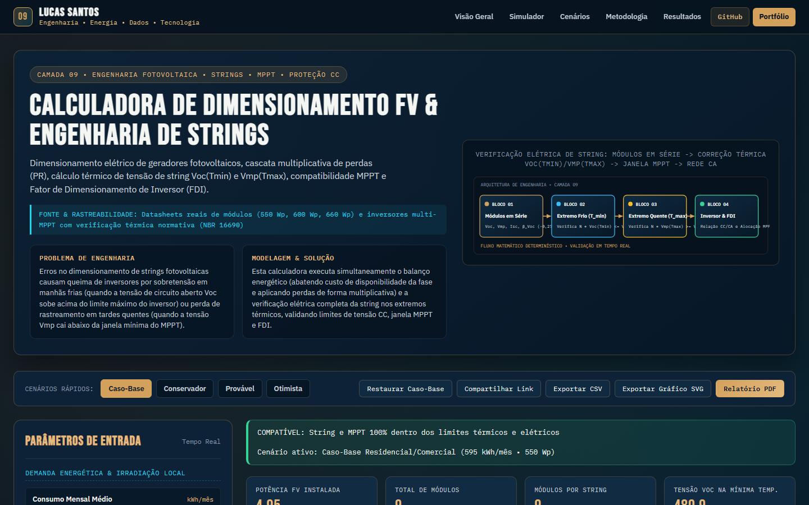

# Calculadora de Dimensionamento FV & Engenharia de Strings

> **Camada 09 do Ecossistema de Engenharia Interativa V3 • Engenharia Fotovoltaica • Strings • MPPT • Proteção CC**  
> Dimensionamento elétrico de geradores fotovoltaicos, cascata multiplicativa de perdas (PR), cálculo térmico de tensão de string Voc(Tmin) e Vmp(Tmax), compatibilidade MPPT e Fator de Dimensionamento de Inversor (FDI).

[](https://luscaarmstrong1.github.io/solar-pv-sizing-calculator/)
[](https://github.com/luscaarmstrong1/solar-pv-sizing-calculator)
[](https://luscaarmstrong1.github.io/solar-pv-sizing-calculator/)
[](https://lucassantos.eng.br/#arquitetura)
[](https://github.com/luscaarmstrong1/solar-pv-sizing-calculator)

---

## 1. Resumo Executivo

Este repositório integra o ecossistema de **Engenharia Interativa V3** de **Lucas Santos**, combinando modelagem física e técnico-econômica em Python com um **Simulador Web Interativo publicado no GitHub Pages** ([https://luscaarmstrong1.github.io/solar-pv-sizing-calculator/](https://luscaarmstrong1.github.io/solar-pv-sizing-calculator/)).

- **Rastreabilidade dos Dados e Modelo:** Datasheets reais de módulos (550 Wp, 600 Wp, 660 Wp) e inversores multi-MPPT com verificação térmica normativa (NBR 16690).
- **Aplicação Web Autônoma:** Executa integralmente no navegador sem dependências externas frágeis, com validação de fronteira, comparador multicenário e exportação técnica (CSV, SVG e Relatório PDF).

---

## 2. Problema de Engenharia Abordado

Erros no dimensionamento de strings fotovoltaicas causam queima de inversores por sobretensão em manhãs frias (quando a tensão de circuito aberto Voc sobe acima do limite máximo do inversor) ou perda de rastreamento em tardes quentes (quando a tensão Vmp cai abaixo da janela mínima do MPPT).

---

## 3. Solução Proposta

Esta calculadora executa simultaneamente o balanço energético (abatendo custo de disponibilidade da fase e aplicando perdas de forma multiplicativa) e a verificação elétrica completa da string nos extremos térmicos, validando limites de tensão CC, janela MPPT e FDI.

---

## 4. Funcionalidades Principais da Aplicação Interativa (V3)

1. **Painel Paramétrico Sincronizado (Slider + Input Numérico):** Controles duplos bidirecionais agrupados por domínio físico, operacional e econômico, com validação contra valores inválidos (`NaN`, `Infinity` ou fora de faixa).
2. **Motor Matemático Determinístico Auditado:** Recálculo instantâneo de todos os indicadores-chave (KPIs), balanços energéticos e séries temporais/financeiras.
3. **Múltiplas Visualizações Gráficas em Alta Nitidez (SVG):** Abas dedicadas com gráficos vetoriais responsivos e tooltips informativos.
4. **Comparador Multicenário Lado a Lado:** Comparação simultânea entre **Caso-Base**, **Conservador**, **Provável**, **Otimista** e a **Simulação Atual** do usuário.
5. **Diagnóstico Técnico Automatizado:** Geração dinâmica de alertas operacionais e recomendações de engenharia conforme os parâmetros configurados.
6. **Exportação e Compartilhamento:**
   - **Compartilhar Link:** Codifica todos os parâmetros na URL (`?param=valor`) para reprodutibilidade exata.
   - **Exportar CSV:** Download imediato da tabela de memória de cálculo.
   - **Exportar Gráfico SVG:** Download vetorial do gráfico ativo.
   - **Relatório PDF:** Folha de estilo dedicada para impressão técnica.

---

## 5. Demonstração Visual (Captura Real V3)



- **Acesse o Simulador Interativo:** [https://luscaarmstrong1.github.io/solar-pv-sizing-calculator/](https://luscaarmstrong1.github.io/solar-pv-sizing-calculator/)
- **Voltar à Seção #arquitetura no Portfólio:** [https://lucassantos.eng.br/#arquitetura](https://lucassantos.eng.br/#arquitetura)

---

## 6. Arquitetura Técnica e Fluxo de Dados

```text
[Parâmetros do Usuário / Presets de Cenário]
                 │
                 ▼
[Validação de Fronteira & Normalização Física]
                 │
                 ▼
[Motor Matemático Determinístico (Python & JS Engine V3)]
                 │
     ┌───────────┼───────────┐
     ▼           ▼           ▼
[KPI Cards] [Gráficos SVG] [Matriz Multicenário & Exportação CSV/PDF]
```

---

## 7. Metodologia e Equações Governantes

### 9.1. Performance Ratio (PR) por Composição Multiplicativa de Perdas

```text
PR = Π_k (1 - l_k) = (1 - l_térmica) * (1 - l_óptica) * (1 - l_cabos) * (1 - l_inversor)
```

Evita o erro clássico de somar percentuais linearmente; calcula o rendimento real encadeado.

### 9.2. Limites Térmicos de Tensão da String (ABNT NBR 16690)

```text
Voc(T_min) = N_s * Voc_STC * [1 + β_Voc * (T_min - 25)] <= V_max_inversor
```

Como β_Voc é negativo (-0,25% a -0,27%/°C), temperaturas baixas elevam a tensão Voc, determinando o número máximo absoluto de módulos em série.

### 9.3. Verificação da Janela Mínima de Rastreamento MPPT a Quente

```text
Vmp(T_max) = N_s * Vmp_STC * [1 + β_Vmp * (T_max - 25)] >= V_MPPT_min
```

Garante que mesmo sob temperatura celular de 70 °C a tensão da string permaneça acima da tensão mínima de partida do MPPT.

---

## 8. Premissas e Limitações do Modelo

- **Escopo Analítico:** Os resultados constituem estudos preliminares de engenharia e viabilidade técnico-econômica. Projetos executivos requerem medições locais de campanha, estudos de curto-circuito/coordenação de proteção e parecer formal da concessionária ou ONS/CCEE.
- **Conservação Física:** Nenhuma eficiência excede 100%, nenhum despacho de bateria viola `[SOC_min, SOC_max]` e todas as séries respeitam limites físicos estritos.

---

## 9. Parâmetros de Entrada e Faixas Aceitas

| Parâmetro | Unidade | Faixa Permitida | Valor Padrão | Descrição Técnica |
|---|---|---|---|---|
| **Consumo Mensal Médio** (`consumoMensalKwh`) | kWh/mês | [120 a 45000] | `595` | Consumo mensal médio apurado nas últimas 12 faturas. |
| **Custo de Disponibilidade ( Padrão de Entrada)** (`custoDisponibilidadeKwh`) | kWh | 30 / 50 / 100 | `100` | Franquia mínima faturada pela distribuidora conforme tipo de ligação. |
| **Horas de Sol Pleno (HSP)** (`hsp`) | kWh/m²/dia | [3.2 a 6.8] | `4.9` | Irradiação solar diária média no plano inclinado. |
| **Especificação do Módulo FV** (`moduloPreset`) | Wp | 550 / 600 / 660 | `550` | Define os parâmetros elétricos STC e coeficientes térmicos do módulo. |
| **Inversor Interativo Selecionado** (`inversorPreset`) | kW | 6 / 10 / 25 / 75 | `6` | Define os limites de tensão máxima de entrada e faixa operacional do MPPT. |
| **Temperatura Mínima Histórica (T_min)** (`tMinRecord`) | °C | [-15 a 20] | `-2` | Menor temperatura ambiente local para cálculo da sobretensão Voc a frio. |
| **Temperatura Máxima de Célula (T_max)** (`tMaxCell`) | °C | [45 a 90] | `70` | Temperatura máxima atingida pela célula sob sol pleno para verificar queda de Vmp. |
| **Perda Térmica Média Anual** (`perdaTermicaPct`) | % | [2 a 18] | `8.5` | Perda energética anual por operação acima de 25 °C. |
| **Perdas Ópticas, Cabos, Sujidade & Inversor** (`perdaOutrasPct`) | % | [4 a 25] | `12.3` | Perdas complementares combinadas de forma multiplicativa no PR. |
| **Módulos em Série por String (0 = Auto)** (`modPorStringManual`) | mód/str | [0 a 26] | `0` | Deixe 0 para cálculo automático ótimo ou informe um valor para testar sobretensão/subtensão. |

---

## 10. Indicadores de Saída (KPIs Explicados)

| Indicador (KPI) | Unidade | Interpretação de Engenharia |
|---|---|---|
| **Potência FV Instalada** (`installedKwp`) | kWp | Potência total CC do gerador |
| **Total de Módulos** (`nModTotal`) | unid. | Quantidade inteira dimensionada |
| **Módulos por String** (`modPerString`) | mód/série | Comprimento elétrico da série |
| **Tensão Voc na Mínima Temp.** (`vocStringColdV`) | V CC | Tensão crítica de circuito aberto a frio |
| **Tensão Vmp na Máxima Temp.** (`vmpStringHotV`) | V CC | Tensão operacional mínima a quente |
| **Limite Máximo por String** (`nMaxString`) | módulos | Teto seguro para não exceder Vmáx |
| **Performance Ratio (PR)** (`prPct`) | % | Produto multiplicativo das eficiências |
| **Fator Dimensionamento (FDI)** (`fdi`) | CC/CA | Relação Potência FV / Potência Inversor |

---

## 11. Estrutura de Diretórios do Repositório

```text
solar-pv-sizing-calculator/
├── docs/                       # Aplicação Web Interativa V3 (GitHub Pages)
│   ├── index.html              # Interface completa com esquemático SVG e seções técnicas
│   ├── simulator.css           # Design System Dark Technical Navy + Copper Gold V3
│   ├── simulator.js            # Motor matemático JS auditado + renderizador gráfico SVG
│   └── assets/
│       └── v3-preview.png      # Captura real da interface V3 em 1440x900
├── src/                        # Módulos Python de engenharia, simulação e pipeline de dados
├── data/                       # Datasets de referência, séries curadas e saídas analíticas
├── tests/                      # Testes automatizados de consistência matemática
└── README.md                   # Documentação técnica completa (18 seções)
```

---

## 12. Como Executar Localmente

### 12.1. Simulador Web Interativo (Zero Dependências)

```bash
git clone https://github.com/luscaarmstrong1/solar-pv-sizing-calculator.git
cd solar-pv-sizing-calculator
npx serve docs
```

Ou abra `docs/index.html` em qualquer servidor HTTP estático local.

### 12.2. Pipeline Analítico em Python

```bash
python -m venv .venv
.venv\Scripts\activate
pip install -r requirements.txt
pytest
```

---

## 13. Como Executar os Testes Automatizados

- **Validação Matemática e de Fronteira:** Verifica ausência de `NaN`/`Infinity`, conservação de energia, monotonia econômica e casos analíticos de referência.
- **Validação E2E e Responsiva (Playwright):** Verifica 0 erros de console, atualização dinâmica de KPIs e gráficos e 0px de overflow horizontal em `320x568`, `390x844`, `768x1024`, `1024x768` e `1440x900`.

---

## 14. Casos de Uso Práticos

1. **Estudos Preliminares de Engenharia e Propostas Técnicas:** Avaliação rápida de sensibilidade junto a clientes industriais e comerciais.
2. **Auditoria de Premissas Técnico-Econômicas:** Comparação transparente entre cenários conservadores, prováveis e otimistas.
3. **Demonstração de Competência Multidisciplinar:** Integração real entre engenharia elétrica, regulação, ciência de dados e desenvolvimento full-stack.

---

## 15. Próximas Evoluções Técnicas

- Integração via API REST com séries meteorológicas INMET/NSRDB e dados horários CCEE/ONS em tempo real.
- Otimização estocástica via Monte Carlo para quantificação de VaR (Value at Risk) energético.

---

## 16. Autor e Contato Profissional

**Lucas Santos**  
*Engenheiro Eletricista • Sistemas de Potência, Energias Renováveis, Dados & Software*

- **Portfólio Principal:** [https://lucassantos.eng.br](https://lucassantos.eng.br)
- **Seção de Engenharia Interativa:** [https://lucassantos.eng.br/#arquitetura](https://lucassantos.eng.br/#arquitetura)
- **GitHub:** [https://github.com/luscaarmstrong1](https://github.com/luscaarmstrong1)
